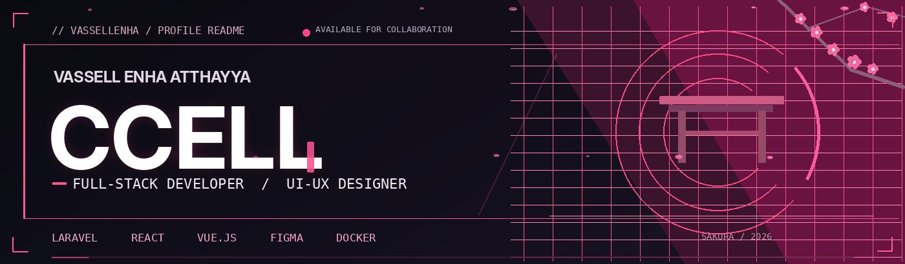
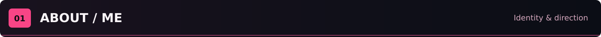
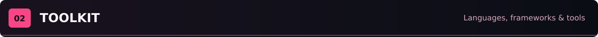
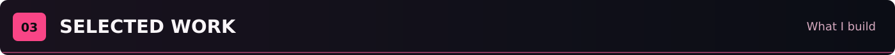
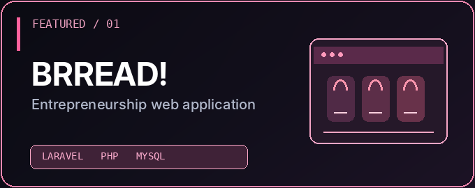
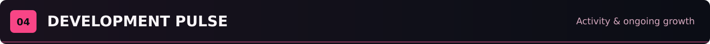
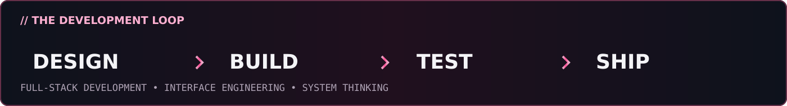
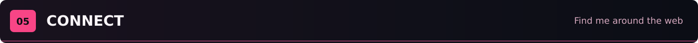
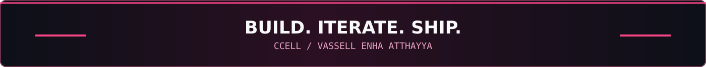

<!-- CCELL / BLACK CHERRY SAKURA — GitHub Profile README -->

 

  

<table><tr><td width="73%" valign="top">

<h3>I build web apps and design their interfaces.</h3>

I'm <b>Vassell Enha Atthayya</b>, or <b>ccell</b>. I study Information Systems at <b>Telkom University</b> and work on full-stack web apps, interface design and cloud deployment.

I like taking an idea all the way to a working product, and I want to understand every layer of it, from the database to the deploy.

<ul>
<li><b>Building:</b> BRREAD!, an entrepreneurship web app</li>
<li><b>Learning:</b> Docker, cloud deployment, Vue.js, and Lua</li>
<li><b>Open to:</b> Full-stack, UI/UX, and game-development collaborations</li>
<li><b>Beyond code:</b> national achievements in business model canvas and business proposal competitions (2026)</li>
</ul>

<pre><code>const ccell = {
  role: 'Full-Stack Developer',
  focus: ['web', 'design', 'cloud'],
  principle: 'Build things that work.'
};</code></pre>

</td><td width="27%" align="center" valign="top">

</td></tr></table>

**FRONTEND & INTERFACE**

**BACKEND & DATABASES**

**DEVELOPER WORKFLOW**

<b>Explore the full stack + current learning track</b>

- **Build:** Laravel, PHP, React, Vue.js, JavaScript/TypeScript, MySQL.
- **Design:** Figma, responsive UI, component systems, user flows.
- **Systems:** RBAC, SLA-based workflows, REST APIs, Git.
- **Exploring:** Docker, cloud deployment, Lua and Roblox Studio.

<table><tr>
<td width="50%" valign="top">

<h3>BRREAD! — Business Web App</h3>

Entrepreneurship platform with customer storefront, staff-role access and inventory management workflows.

<code>Laravel</code> <code>PHP</code> <code>MySQL</code>

<a href="https://github.com/vassellenha/KWU-BRREAD">Explore the repository</a>

</td>
<td width="50%" valign="top">

<h3>Catch &amp; Clash — Roblox</h3>

Game-development project focused on Roblox experiences and Lua-based gameplay systems.

<code>Roblox Studio</code> <code>Lua</code> <code>Game Development</code>

<a href="https://github.com/vassellenha/CatchAndClash_Roblox_Project">Explore the repository</a>

</td>
</tr></table>

<b>More projects — Vue Lab, AMANIN, PHARVIA</b>

**[Vue UI Lab](https://github.com/vassellenha/PRAKTIKUM_UI-LANJUT_VASSELL-ENHA-ATTHAYYA_102042300140)** — Vue.js components, state management, routing, and REST API integration.

**[AMANIN](https://github.com/vassellenha/AMANIN-Project)** — AI-assisted anti-scam decision assistant concept.

**[PHARVIA](https://github.com/vassellenha/Pharvia-Project)** — Pharmaceutical return and traceability business concept.

 

I work at the intersection of **software engineering, UI/UX, and product thinking**. If you're working on a meaningful web application or collaborative build, let's connect.

  

