<!-- VASSELL ENHA ATTHAYYA // ABSOLUTE OVERDRIVE V5 -->
<!-- Every graphical element is a locally rendered GitHub-compatible image. -->
<!-- User-supplied original character artwork appears in the HERO SECTION ONLY. -->
<!-- All other visuals are original code-generated typographic/interface artwork. -->

<a href="https://github.com/vassellenha">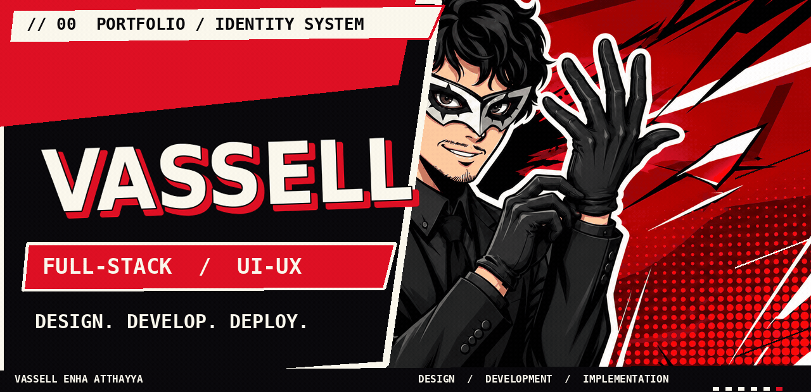</a>

<a href="#about">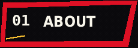</a>
<a href="#arsenal">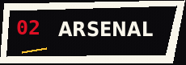</a>
<a href="#projects">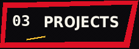</a>
<a href="#activity">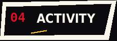</a>
<a href="#contact">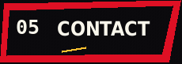</a>

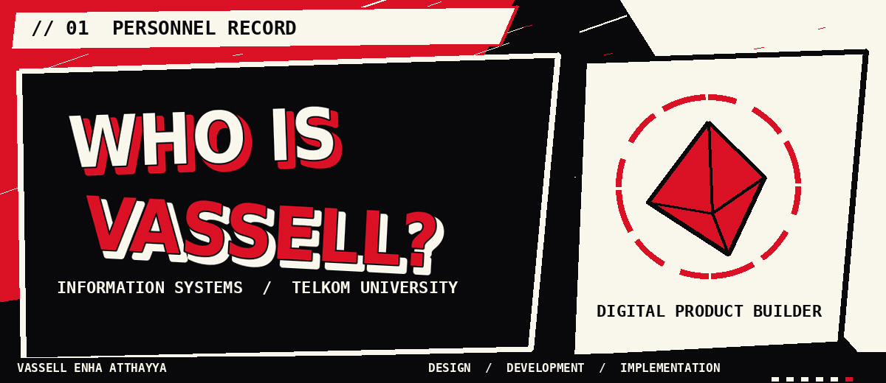

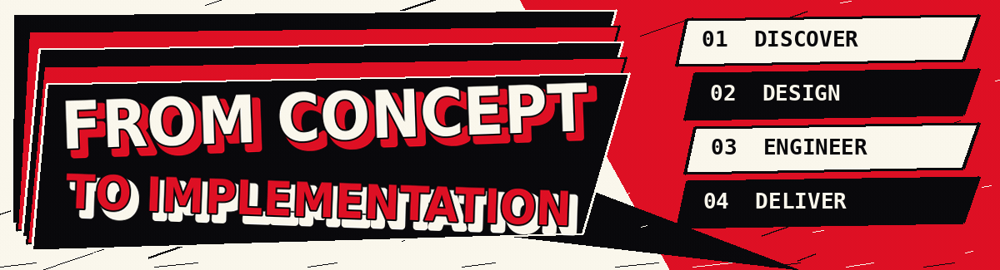

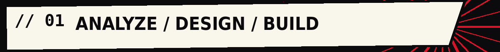

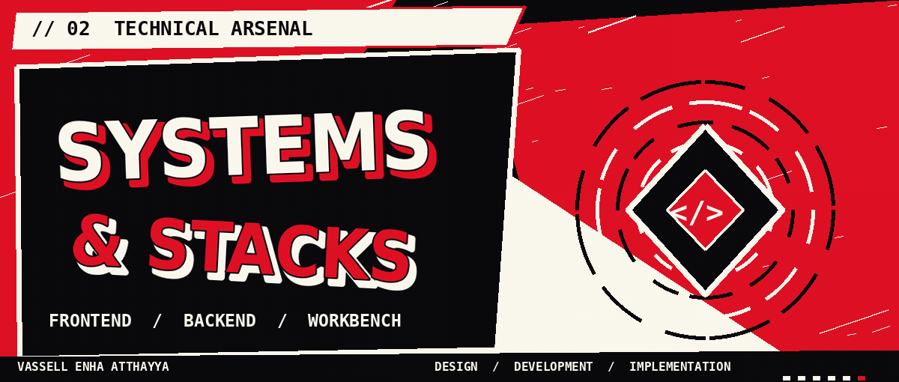

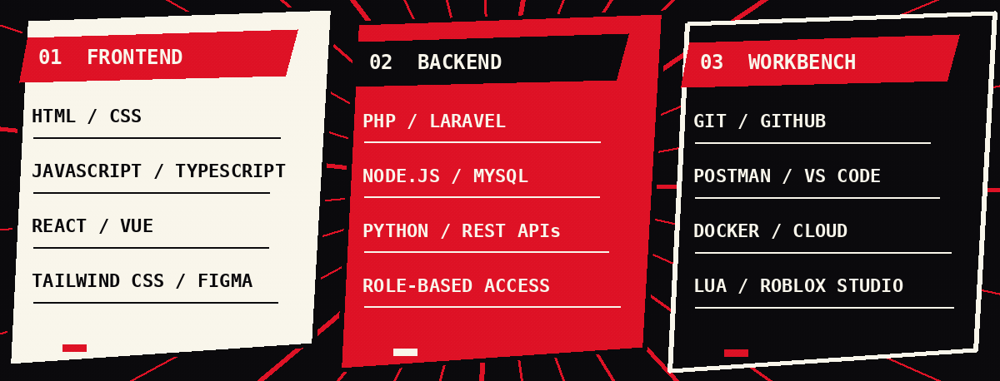

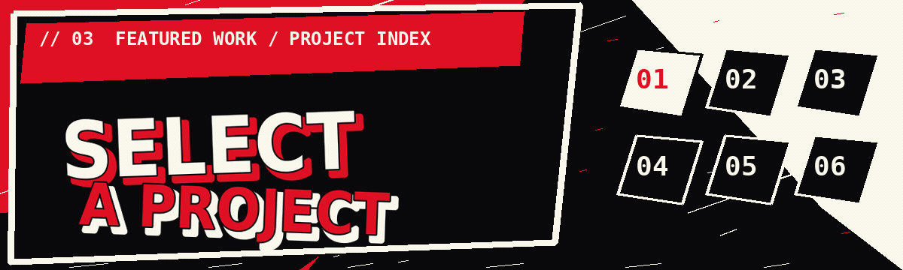

<a href="https://github.com/vassellenha/Portofolio-Vassell-Persona-Inspired">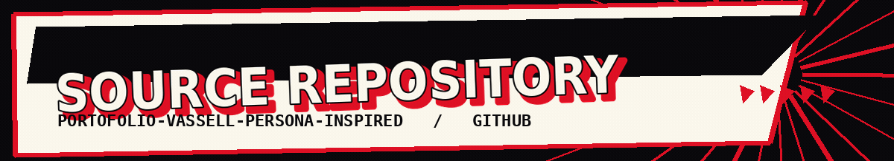</a>

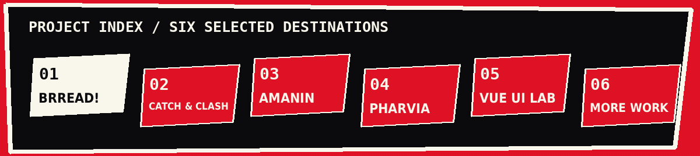

<a href="https://github.com/vassellenha/KWU-BRREAD">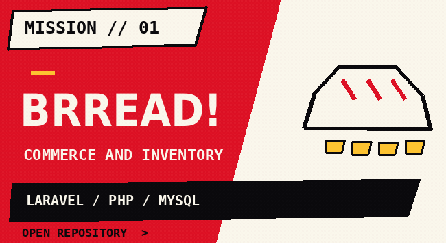</a>
<a href="https://github.com/vassellenha/CatchAndClash_Roblox_Project">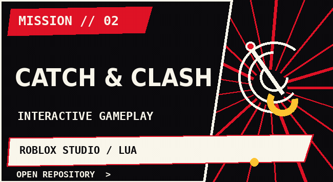</a>

<a href="https://github.com/vassellenha/AMANIN-Project">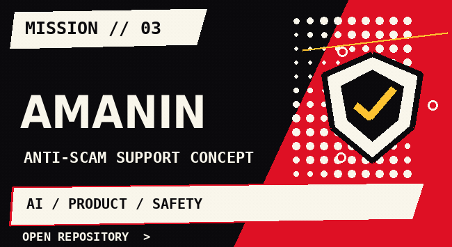</a>
<a href="https://github.com/vassellenha/PHARVIA-Project">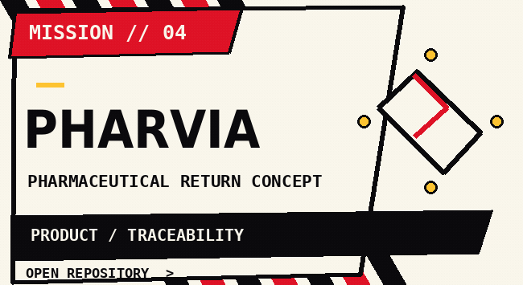</a>

<a href="https://github.com/vassellenha/PRAKTIKUM_UI-LANJUT_VASSELL-ENHA-ATTHAYYA_102042300140">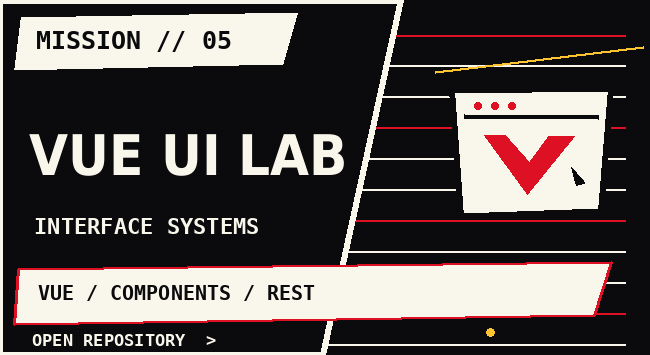</a>
<a href="https://github.com/vassellenha?tab=repositories">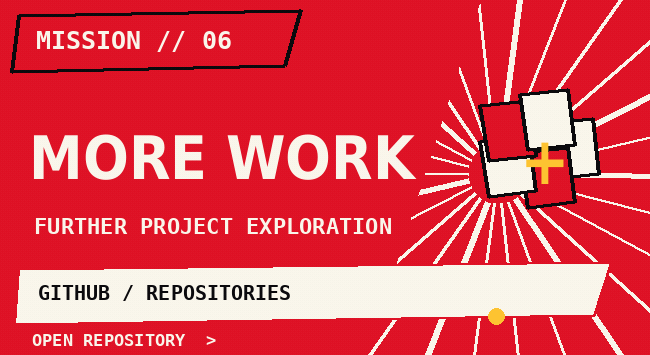</a>

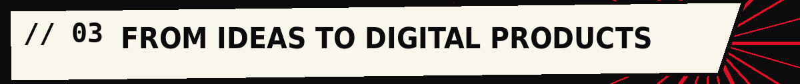

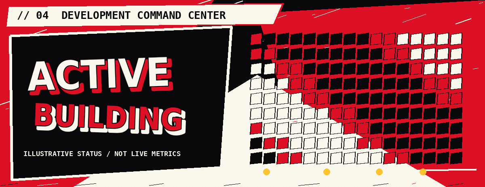

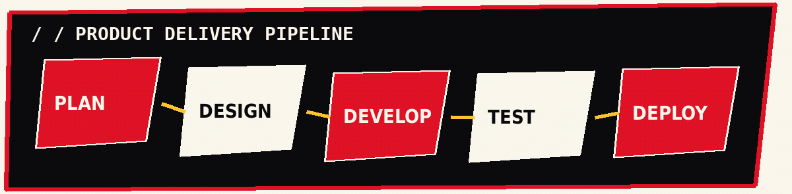

<a href="https://github.com/vassellenha?tab=overview">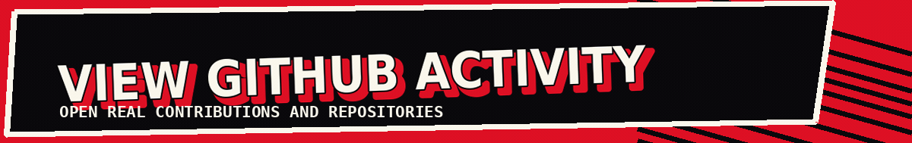</a>

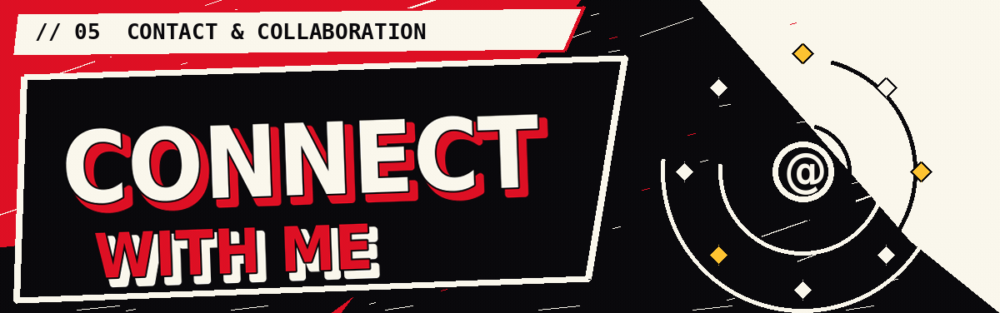

<a href="https://github.com/vassellenha">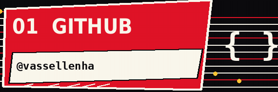</a>
<a href="https://www.linkedin.com/in/vassell-enha-atthayya-182661323/">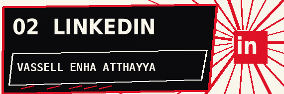</a>

<a href="https://instagram.com/vassellenha">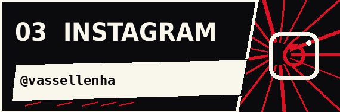</a>
<a href="https://takeyourcode.vercel.app/#home">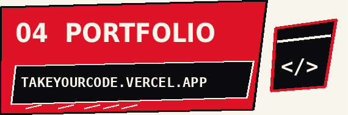</a>

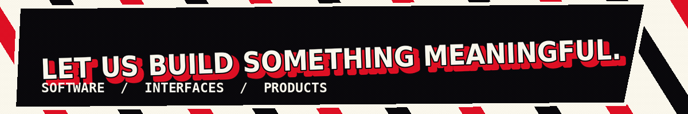

<a href="#top">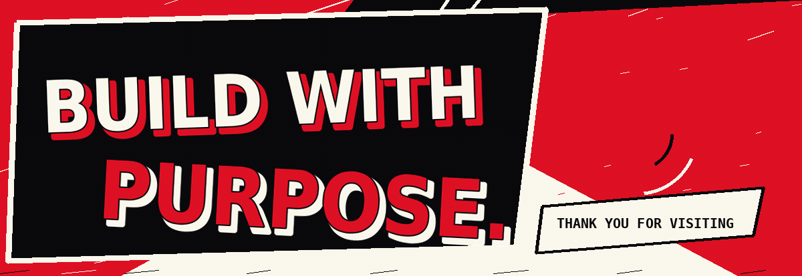</a>

<a href="#top">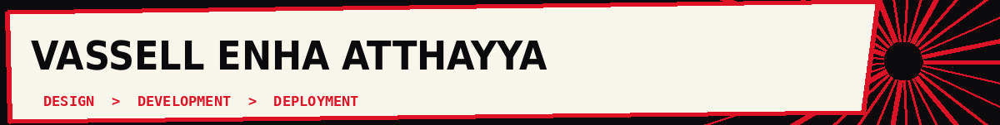</a>

