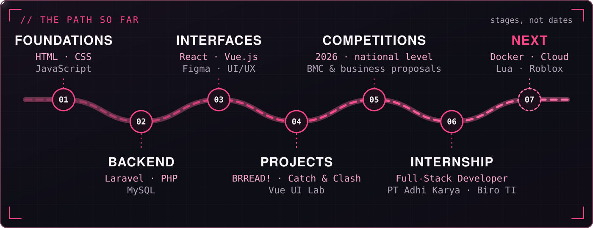

<!-- CCELL / BLACK CHERRY SAKURA — GitHub Profile README -->
<!-- psst: the torii near the bottom is a real 3D model. drag it. -->
<a id="top"></a>
<div align="center">

<a href="https://github.com/vassellenha"></a>

<br />

<a href="#about"></a>
<a href="#toolkit"></a>
<a href="#work"></a>
<a href="#activity"></a>
<a href="#connect"></a>

<br /><br />

<a href="https://github.com/vassellenha?tab=repositories"></a>
<a href="https://websiteportofoliokelompok5.vercel.app/"></a>
<a href="https://www.linkedin.com/in/vassell-enha-atthayya-182661323"></a>
<a href="https://instagram.com/vassellenha"></a>

<br /><br />


<br />


</div>


<a id="about"></a>


<table><tr><td width="73%" valign="top">

<h3>I build web apps and design their interfaces.</h3>

<p>I'm <b>Vassell Enha Atthayya</b>, or <b>ccell</b>. I study Information Systems at <b>Telkom University</b> and work on full-stack web apps, interface design and cloud deployment.</p>

<p>I like taking an idea all the way to a working product, and I want to understand every layer of it, from the database to the deploy.</p>

<p>&nbsp; <b>Building</b><br />BRREAD!, an entrepreneurship web app<br /></p>

<p>&nbsp; <b>Learning</b><br />Docker, cloud deployment, Vue.js and Lua<br /></p>

<p>&nbsp; <b>Open to</b><br />Full-stack, UI/UX and game-development collaborations</p>

<p>&nbsp; <b>Beyond code</b><br />National achievements in business model canvas and business proposal competitions (2026)</p>

</td><td width="27%" align="center" valign="middle">


</td></tr></table>

<br />

<div align="center">



<br /><br />



</div>

<br />

<div align="center"><b>[ PICK YOUR PATH ]</b> &nbsp;·&nbsp; <sub>click a card to expand it</sub></div>

<table>
<tr>
<td width="33%" valign="top">
<details>
<summary><b>[ HIRING / SUPERVISING ]</b></summary>
<br />
Full-stack delivery from schema to deploy, with the interface design to match.
<br /><br />
<code>Laravel</code> <code>PHP</code> <code>MySQL</code> back ends<br />
<code>React</code> <code>Vue.js</code> front ends<br />
<code>RBAC</code> <code>SLA workflows</code> <code>REST APIs</code><br />
<code>Figma</code> component systems and user flows
<br /><br />
<a href="#work"><b>Selected work</b></a> · <a href="https://www.linkedin.com/in/vassell-enha-atthayya-182661323"><b>LinkedIn</b></a> · <a href="https://websiteportofoliokelompok5.vercel.app/"><b>Portfolio</b></a>
</details>
</td>
<td width="33%" valign="top">
<details>
<summary><b>[ COLLABORATING ]</b></summary>
<br />
Open to full-stack, UI/UX and game-development collaborations.
<br /><br />
Working on a meaningful web application or a collaborative build? Let's talk.
<br /><br />
<a href="#connect"><b>Connect</b></a> · <a href="https://www.linkedin.com/in/vassell-enha-atthayya-182661323"><b>LinkedIn</b></a> · <a href="https://instagram.com/vassellenha"><b>Instagram</b></a>
</details>
</td>
<td width="33%" valign="top">
<details>
<summary><b>[ GAME DEV / ROBLOX ]</b></summary>
<br />
<b>Catch &amp; Clash</b> is my Roblox project: Lua-based gameplay systems built in Roblox Studio.
<br /><br />
Still learning Lua and Roblox Studio, and happy to team up on game builds.
<br /><br />
<a href="https://github.com/vassellenha/CatchAndClash_Roblox_Project"><b>Open the repository</b></a>
</details>
</td>
</tr>
</table>

<div align="right"><a href="#top"></a></div>


<a id="toolkit"></a>


<div align="center">



<br /><br />

**FRONTEND & INTERFACE**


**BACKEND & DATABASES**


**DEVELOPER WORKFLOW**


</div>

<details><summary><b>Explore the full stack + current learning track</b></summary>

- **Build:** Laravel, PHP, React, Vue.js, JavaScript/TypeScript, MySQL.
- **Design:** Figma, responsive UI, component systems, user flows.
- **Systems:** RBAC, SLA-based workflows, REST APIs, Git.
- **Exploring:** Docker, cloud deployment, Lua and Roblox Studio.

</details>

<div align="right"><a href="#top"></a></div>


<a id="work"></a>


<table><tr>
<td width="50%" valign="top">
<a href="https://github.com/vassellenha/KWU-BRREAD"></a>

<h3>BRREAD! — Business Web App</h3>
<p>Entrepreneurship platform with customer storefront, staff-role access and inventory management workflows.</p>
<p><code>Laravel</code> <code>PHP</code> <code>MySQL</code></p>
<p><a href="https://github.com/vassellenha/KWU-BRREAD">Explore the repository</a></p>
</td>
<td width="50%" valign="top">
<a href="https://github.com/vassellenha/CatchAndClash_Roblox_Project"></a>

<h3>Catch &amp; Clash — Roblox</h3>
<p>Game-development project focused on Roblox experiences and Lua-based gameplay systems.</p>
<p><code>Roblox Studio</code> <code>Lua</code> <code>Game Development</code></p>
<p><a href="https://github.com/vassellenha/CatchAndClash_Roblox_Project">Explore the repository</a></p>
</td>
</tr></table>

<table><tr>
<td width="50%" valign="top">
<a href="https://github.com/vassellenha/AMANIN-Project"></a>

<h3>AMANIN — AI Anti-Scam Assistant</h3>
<p>AI-assisted anti-scam decision assistant concept.</p>
<p><code>AI</code> <code>Decision Support</code> <code>Product Concept</code></p>
<p><a href="https://github.com/vassellenha/AMANIN-Project">Explore the repository</a></p>
</td>
<td width="50%" valign="top">
<a href="https://github.com/vassellenha/Pharvia-Project"></a>

<h3>PHARVIA — Pharma Traceability</h3>
<p>Pharmaceutical return and traceability business concept.</p>
<p><code>Healthcare</code> <code>Traceability</code> <code>Business Concept</code></p>
<p><a href="https://github.com/vassellenha/Pharvia-Project">Explore the repository</a></p>
</td>
</tr></table>

<table><tr>
<td width="50%" valign="top">
<a href="https://github.com/vassellenha/PRAKTIKUM_UI-LANJUT_VASSELL-ENHA-ATTHAYYA_102042300140"></a>

<h3>Vue UI Lab</h3>
<p>Vue.js components, state management, routing, and REST API integration.</p>
<p><code>Vue.js</code> <code>Routing</code> <code>REST API</code></p>
<p><a href="https://github.com/vassellenha/PRAKTIKUM_UI-LANJUT_VASSELL-ENHA-ATTHAYYA_102042300140">Explore the repository</a></p>
</td>
<td width="50%" valign="top">
<a href="https://github.com/vassellenha?tab=repositories"></a>

<h3>More Work</h3>
<p>Every other repository lives on GitHub.</p>
<p><code>Laravel</code> <code>Vue</code> <code>Lua</code></p>
<p><a href="https://github.com/vassellenha?tab=repositories">Browse all repositories</a></p>
</td>
</tr></table>

<div align="center">



</div>

<div align="right"><a href="#top"></a></div>


<a id="activity"></a>


<div align="center">

<a href="https://github.com/vassellenha?tab=overview"></a>

<a href="https://github.com/vassellenha?tab=overview"></a>

<br /><br />

<picture>
  <source media="(prefers-color-scheme: dark)" srcset="https://raw.githubusercontent.com/vassellenha/vassellenha/output/github-snake-dark.svg" />
  <source media="(prefers-color-scheme: light)" srcset="https://raw.githubusercontent.com/vassellenha/vassellenha/output/github-snake.svg" />
  
</picture>

<br />


<br />


<br />


<br />

<a href="https://github.com/vassellenha?tab=overview"></a>

</div>

<div align="right"><a href="#top"></a></div>


<a id="connect"></a>


I work at the intersection of **software engineering, UI/UX, and product thinking**. If you're working on a meaningful web application or collaborative build, let's connect.

<div align="center">

<a href="https://github.com/vassellenha?tab=repositories"></a>
<a href="https://www.linkedin.com/in/vassell-enha-atthayya-182661323"></a>
<br />
<a href="https://instagram.com/vassellenha"></a>
<a href="https://websiteportofoliokelompok5.vercel.app/"></a>

<br /><br />

<details>
<summary><b>./torii.stl — a real 3D torii. Drag to rotate, scroll to zoom.</b></summary>

```stl
solid torii
facet normal -0.000 -0.000 -1.000
outer loop
vertex -4.30 -0.55 0.00
vertex -3.20 0.55 0.00
vertex -3.20 -0.55 0.00
endloop
endfacet
facet normal -0.000 -0.000 -1.000
outer loop
vertex -4.30 -0.55 0.00
vertex -4.30 0.55 0.00
vertex -3.20 0.55 0.00
endloop
endfacet
facet normal 0.000 0.000 1.000
outer loop
vertex -4.30 -0.55 10.00
vertex -3.20 -0.55 10.00
vertex -3.20 0.55 10.00
endloop
endfacet
facet normal 0.000 0.000 1.000
outer loop
vertex -4.30 -0.55 10.00
vertex -3.20 0.55 10.00
vertex -4.30 0.55 10.00
endloop
endfacet
facet normal 0.000 -1.000 0.000
outer loop
vertex -4.30 -0.55 0.00
vertex -3.20 -0.55 0.00
vertex -3.20 -0.55 10.00
endloop
endfacet
facet normal 0.000 -1.000 0.000
outer loop
vertex -4.30 -0.55 0.00
vertex -3.20 -0.55 10.00
vertex -4.30 -0.55 10.00
endloop
endfacet
facet normal 1.000 0.000 0.000
outer loop
vertex -3.20 -0.55 0.00
vertex -3.20 0.55 0.00
vertex -3.20 0.55 10.00
endloop
endfacet
facet normal 1.000 0.000 0.000
outer loop
vertex -3.20 -0.55 0.00
vertex -3.20 0.55 10.00
vertex -3.20 -0.55 10.00
endloop
endfacet
facet normal 0.000 1.000 0.000
outer loop
vertex -3.20 0.55 0.00
vertex -4.30 0.55 0.00
vertex -4.30 0.55 10.00
endloop
endfacet
facet normal 0.000 1.000 -0.000
outer loop
vertex -3.20 0.55 0.00
vertex -4.30 0.55 10.00
vertex -3.20 0.55 10.00
endloop
endfacet
facet normal -1.000 0.000 0.000
outer loop
vertex -4.30 0.55 0.00
vertex -4.30 -0.55 0.00
vertex -4.30 -0.55 10.00
endloop
endfacet
facet normal -1.000 0.000 0.000
outer loop
vertex -4.30 0.55 0.00
vertex -4.30 -0.55 10.00
vertex -4.30 0.55 10.00
endloop
endfacet
facet normal -0.000 -0.000 -1.000
outer loop
vertex -4.60 -0.90 -0.50
vertex -2.90 0.90 -0.50
vertex -2.90 -0.90 -0.50
endloop
endfacet
facet normal -0.000 -0.000 -1.000
outer loop
vertex -4.60 -0.90 -0.50
vertex -4.60 0.90 -0.50
vertex -2.90 0.90 -0.50
endloop
endfacet
facet normal 0.000 0.000 1.000
outer loop
vertex -4.60 -0.90 0.00
vertex -2.90 -0.90 0.00
vertex -2.90 0.90 0.00
endloop
endfacet
facet normal 0.000 0.000 1.000
outer loop
vertex -4.60 -0.90 0.00
vertex -2.90 0.90 0.00
vertex -4.60 0.90 0.00
endloop
endfacet
facet normal 0.000 -1.000 0.000
outer loop
vertex -4.60 -0.90 -0.50
vertex -2.90 -0.90 -0.50
vertex -2.90 -0.90 0.00
endloop
endfacet
facet normal 0.000 -1.000 0.000
outer loop
vertex -4.60 -0.90 -0.50
vertex -2.90 -0.90 0.00
vertex -4.60 -0.90 0.00
endloop
endfacet
facet normal 1.000 0.000 0.000
outer loop
vertex -2.90 -0.90 -0.50
vertex -2.90 0.90 -0.50
vertex -2.90 0.90 0.00
endloop
endfacet
facet normal 1.000 0.000 0.000
outer loop
vertex -2.90 -0.90 -0.50
vertex -2.90 0.90 0.00
vertex -2.90 -0.90 0.00
endloop
endfacet
facet normal 0.000 1.000 0.000
outer loop
vertex -2.90 0.90 -0.50
vertex -4.60 0.90 -0.50
vertex -4.60 0.90 0.00
endloop
endfacet
facet normal 0.000 1.000 -0.000
outer loop
vertex -2.90 0.90 -0.50
vertex -4.60 0.90 0.00
vertex -2.90 0.90 0.00
endloop
endfacet
facet normal -1.000 0.000 0.000
outer loop
vertex -4.60 0.90 -0.50
vertex -4.60 -0.90 -0.50
vertex -4.60 -0.90 0.00
endloop
endfacet
facet normal -1.000 0.000 0.000
outer loop
vertex -4.60 0.90 -0.50
vertex -4.60 -0.90 0.00
vertex -4.60 0.90 0.00
endloop
endfacet
facet normal -0.000 -0.000 -1.000
outer loop
vertex 3.20 -0.55 0.00
vertex 4.30 0.55 0.00
vertex 4.30 -0.55 0.00
endloop
endfacet
facet normal -0.000 -0.000 -1.000
outer loop
vertex 3.20 -0.55 0.00
vertex 3.20 0.55 0.00
vertex 4.30 0.55 0.00
endloop
endfacet
facet normal 0.000 0.000 1.000
outer loop
vertex 3.20 -0.55 10.00
vertex 4.30 -0.55 10.00
vertex 4.30 0.55 10.00
endloop
endfacet
facet normal 0.000 0.000 1.000
outer loop
vertex 3.20 -0.55 10.00
vertex 4.30 0.55 10.00
vertex 3.20 0.55 10.00
endloop
endfacet
facet normal 0.000 -1.000 0.000
outer loop
vertex 3.20 -0.55 0.00
vertex 4.30 -0.55 0.00
vertex 4.30 -0.55 10.00
endloop
endfacet
facet normal 0.000 -1.000 0.000
outer loop
vertex 3.20 -0.55 0.00
vertex 4.30 -0.55 10.00
vertex 3.20 -0.55 10.00
endloop
endfacet
facet normal 1.000 0.000 0.000
outer loop
vertex 4.30 -0.55 0.00
vertex 4.30 0.55 0.00
vertex 4.30 0.55 10.00
endloop
endfacet
facet normal 1.000 0.000 0.000
outer loop
vertex 4.30 -0.55 0.00
vertex 4.30 0.55 10.00
vertex 4.30 -0.55 10.00
endloop
endfacet
facet normal 0.000 1.000 0.000
outer loop
vertex 4.30 0.55 0.00
vertex 3.20 0.55 0.00
vertex 3.20 0.55 10.00
endloop
endfacet
facet normal 0.000 1.000 -0.000
outer loop
vertex 4.30 0.55 0.00
vertex 3.20 0.55 10.00
vertex 4.30 0.55 10.00
endloop
endfacet
facet normal -1.000 0.000 0.000
outer loop
vertex 3.20 0.55 0.00
vertex 3.20 -0.55 0.00
vertex 3.20 -0.55 10.00
endloop
endfacet
facet normal -1.000 0.000 0.000
outer loop
vertex 3.20 0.55 0.00
vertex 3.20 -0.55 10.00
vertex 3.20 0.55 10.00
endloop
endfacet
facet normal -0.000 -0.000 -1.000
outer loop
vertex 2.90 -0.90 -0.50
vertex 4.60 0.90 -0.50
vertex 4.60 -0.90 -0.50
endloop
endfacet
facet normal -0.000 -0.000 -1.000
outer loop
vertex 2.90 -0.90 -0.50
vertex 2.90 0.90 -0.50
vertex 4.60 0.90 -0.50
endloop
endfacet
facet normal 0.000 0.000 1.000
outer loop
vertex 2.90 -0.90 0.00
vertex 4.60 -0.90 0.00
vertex 4.60 0.90 0.00
endloop
endfacet
facet normal 0.000 0.000 1.000
outer loop
vertex 2.90 -0.90 0.00
vertex 4.60 0.90 0.00
vertex 2.90 0.90 0.00
endloop
endfacet
facet normal 0.000 -1.000 0.000
outer loop
vertex 2.90 -0.90 -0.50
vertex 4.60 -0.90 -0.50
vertex 4.60 -0.90 0.00
endloop
endfacet
facet normal 0.000 -1.000 0.000
outer loop
vertex 2.90 -0.90 -0.50
vertex 4.60 -0.90 0.00
vertex 2.90 -0.90 0.00
endloop
endfacet
facet normal 1.000 0.000 0.000
outer loop
vertex 4.60 -0.90 -0.50
vertex 4.60 0.90 -0.50
vertex 4.60 0.90 0.00
endloop
endfacet
facet normal 1.000 0.000 0.000
outer loop
vertex 4.60 -0.90 -0.50
vertex 4.60 0.90 0.00
vertex 4.60 -0.90 0.00
endloop
endfacet
facet normal 0.000 1.000 0.000
outer loop
vertex 4.60 0.90 -0.50
vertex 2.90 0.90 -0.50
vertex 2.90 0.90 0.00
endloop
endfacet
facet normal 0.000 1.000 -0.000
outer loop
vertex 4.60 0.90 -0.50
vertex 2.90 0.90 0.00
vertex 4.60 0.90 0.00
endloop
endfacet
facet normal -1.000 0.000 0.000
outer loop
vertex 2.90 0.90 -0.50
vertex 2.90 -0.90 -0.50
vertex 2.90 -0.90 0.00
endloop
endfacet
facet normal -1.000 0.000 0.000
outer loop
vertex 2.90 0.90 -0.50
vertex 2.90 -0.90 0.00
vertex 2.90 0.90 0.00
endloop
endfacet
facet normal -0.000 -0.000 -1.000
outer loop
vertex -5.00 -0.35 6.40
vertex 5.00 0.35 6.40
vertex 5.00 -0.35 6.40
endloop
endfacet
facet normal -0.000 -0.000 -1.000
outer loop
vertex -5.00 -0.35 6.40
vertex -5.00 0.35 6.40
vertex 5.00 0.35 6.40
endloop
endfacet
facet normal 0.000 0.000 1.000
outer loop
vertex -5.00 -0.35 7.20
vertex 5.00 -0.35 7.20
vertex 5.00 0.35 7.20
endloop
endfacet
facet normal 0.000 0.000 1.000
outer loop
vertex -5.00 -0.35 7.20
vertex 5.00 0.35 7.20
vertex -5.00 0.35 7.20
endloop
endfacet
facet normal 0.000 -1.000 0.000
outer loop
vertex -5.00 -0.35 6.40
vertex 5.00 -0.35 6.40
vertex 5.00 -0.35 7.20
endloop
endfacet
facet normal 0.000 -1.000 0.000
outer loop
vertex -5.00 -0.35 6.40
vertex 5.00 -0.35 7.20
vertex -5.00 -0.35 7.20
endloop
endfacet
facet normal 1.000 0.000 0.000
outer loop
vertex 5.00 -0.35 6.40
vertex 5.00 0.35 6.40
vertex 5.00 0.35 7.20
endloop
endfacet
facet normal 1.000 0.000 0.000
outer loop
vertex 5.00 -0.35 6.40
vertex 5.00 0.35 7.20
vertex 5.00 -0.35 7.20
endloop
endfacet
facet normal 0.000 1.000 0.000
outer loop
vertex 5.00 0.35 6.40
vertex -5.00 0.35 6.40
vertex -5.00 0.35 7.20
endloop
endfacet
facet normal 0.000 1.000 -0.000
outer loop
vertex 5.00 0.35 6.40
vertex -5.00 0.35 7.20
vertex 5.00 0.35 7.20
endloop
endfacet
facet normal -1.000 0.000 0.000
outer loop
vertex -5.00 0.35 6.40
vertex -5.00 -0.35 6.40
vertex -5.00 -0.35 7.20
endloop
endfacet
facet normal -1.000 0.000 0.000
outer loop
vertex -5.00 0.35 6.40
vertex -5.00 -0.35 7.20
vertex -5.00 0.35 7.20
endloop
endfacet
facet normal -0.000 -0.000 -1.000
outer loop
vertex -0.45 -0.30 7.20
vertex 0.45 0.30 7.20
vertex 0.45 -0.30 7.20
endloop
endfacet
facet normal -0.000 -0.000 -1.000
outer loop
vertex -0.45 -0.30 7.20
vertex -0.45 0.30 7.20
vertex 0.45 0.30 7.20
endloop
endfacet
facet normal 0.000 0.000 1.000
outer loop
vertex -0.45 -0.30 9.40
vertex 0.45 -0.30 9.40
vertex 0.45 0.30 9.40
endloop
endfacet
facet normal 0.000 0.000 1.000
outer loop
vertex -0.45 -0.30 9.40
vertex 0.45 0.30 9.40
vertex -0.45 0.30 9.40
endloop
endfacet
facet normal 0.000 -1.000 0.000
outer loop
vertex -0.45 -0.30 7.20
vertex 0.45 -0.30 7.20
vertex 0.45 -0.30 9.40
endloop
endfacet
facet normal 0.000 -1.000 0.000
outer loop
vertex -0.45 -0.30 7.20
vertex 0.45 -0.30 9.40
vertex -0.45 -0.30 9.40
endloop
endfacet
facet normal 1.000 0.000 0.000
outer loop
vertex 0.45 -0.30 7.20
vertex 0.45 0.30 7.20
vertex 0.45 0.30 9.40
endloop
endfacet
facet normal 1.000 0.000 0.000
outer loop
vertex 0.45 -0.30 7.20
vertex 0.45 0.30 9.40
vertex 0.45 -0.30 9.40
endloop
endfacet
facet normal 0.000 1.000 0.000
outer loop
vertex 0.45 0.30 7.20
vertex -0.45 0.30 7.20
vertex -0.45 0.30 9.40
endloop
endfacet
facet normal 0.000 1.000 -0.000
outer loop
vertex 0.45 0.30 7.20
vertex -0.45 0.30 9.40
vertex 0.45 0.30 9.40
endloop
endfacet
facet normal -1.000 0.000 0.000
outer loop
vertex -0.45 0.30 7.20
vertex -0.45 -0.30 7.20
vertex -0.45 -0.30 9.40
endloop
endfacet
facet normal -1.000 0.000 0.000
outer loop
vertex -0.45 0.30 7.20
vertex -0.45 -0.30 9.40
vertex -0.45 0.30 9.40
endloop
endfacet
facet normal -0.000 -0.000 -1.000
outer loop
vertex -5.90 -0.60 9.40
vertex 5.90 0.60 9.40
vertex 5.90 -0.60 9.40
endloop
endfacet
facet normal -0.000 -0.000 -1.000
outer loop
vertex -5.90 -0.60 9.40
vertex -5.90 0.60 9.40
vertex 5.90 0.60 9.40
endloop
endfacet
facet normal 0.000 0.000 1.000
outer loop
vertex -5.90 -0.60 10.20
vertex 5.90 -0.60 10.20
vertex 5.90 0.60 10.20
endloop
endfacet
facet normal 0.000 0.000 1.000
outer loop
vertex -5.90 -0.60 10.20
vertex 5.90 0.60 10.20
vertex -5.90 0.60 10.20
endloop
endfacet
facet normal 0.000 -1.000 0.000
outer loop
vertex -5.90 -0.60 9.40
vertex 5.90 -0.60 9.40
vertex 5.90 -0.60 10.20
endloop
endfacet
facet normal 0.000 -1.000 0.000
outer loop
vertex -5.90 -0.60 9.40
vertex 5.90 -0.60 10.20
vertex -5.90 -0.60 10.20
endloop
endfacet
facet normal 1.000 0.000 0.000
outer loop
vertex 5.90 -0.60 9.40
vertex 5.90 0.60 9.40
vertex 5.90 0.60 10.20
endloop
endfacet
facet normal 1.000 0.000 0.000
outer loop
vertex 5.90 -0.60 9.40
vertex 5.90 0.60 10.20
vertex 5.90 -0.60 10.20
endloop
endfacet
facet normal 0.000 1.000 0.000
outer loop
vertex 5.90 0.60 9.40
vertex -5.90 0.60 9.40
vertex -5.90 0.60 10.20
endloop
endfacet
facet normal 0.000 1.000 -0.000
outer loop
vertex 5.90 0.60 9.40
vertex -5.90 0.60 10.20
vertex 5.90 0.60 10.20
endloop
endfacet
facet normal -1.000 0.000 0.000
outer loop
vertex -5.90 0.60 9.40
vertex -5.90 -0.60 9.40
vertex -5.90 -0.60 10.20
endloop
endfacet
facet normal -1.000 0.000 0.000
outer loop
vertex -5.90 0.60 9.40
vertex -5.90 -0.60 10.20
vertex -5.90 0.60 10.20
endloop
endfacet
facet normal -0.000 -0.000 -1.000
outer loop
vertex -4.20 -0.85 10.20
vertex 4.20 0.85 10.20
vertex 4.20 -0.85 10.20
endloop
endfacet
facet normal -0.000 -0.000 -1.000
outer loop
vertex -4.20 -0.85 10.20
vertex -4.20 0.85 10.20
vertex 4.20 0.85 10.20
endloop
endfacet
facet normal 0.000 0.000 1.000
outer loop
vertex -4.20 -0.85 11.00
vertex 4.20 -0.85 11.00
vertex 4.20 0.85 11.00
endloop
endfacet
facet normal 0.000 0.000 1.000
outer loop
vertex -4.20 -0.85 11.00
vertex 4.20 0.85 11.00
vertex -4.20 0.85 11.00
endloop
endfacet
facet normal 0.000 -1.000 0.000
outer loop
vertex -4.20 -0.85 10.20
vertex 4.20 -0.85 10.20
vertex 4.20 -0.85 11.00
endloop
endfacet
facet normal 0.000 -1.000 0.000
outer loop
vertex -4.20 -0.85 10.20
vertex 4.20 -0.85 11.00
vertex -4.20 -0.85 11.00
endloop
endfacet
facet normal 1.000 0.000 0.000
outer loop
vertex 4.20 -0.85 10.20
vertex 4.20 0.85 10.20
vertex 4.20 0.85 11.00
endloop
endfacet
facet normal 1.000 0.000 0.000
outer loop
vertex 4.20 -0.85 10.20
vertex 4.20 0.85 11.00
vertex 4.20 -0.85 11.00
endloop
endfacet
facet normal 0.000 1.000 0.000
outer loop
vertex 4.20 0.85 10.20
vertex -4.20 0.85 10.20
vertex -4.20 0.85 11.00
endloop
endfacet
facet normal 0.000 1.000 -0.000
outer loop
vertex 4.20 0.85 10.20
vertex -4.20 0.85 11.00
vertex 4.20 0.85 11.00
endloop
endfacet
facet normal -1.000 0.000 0.000
outer loop
vertex -4.20 0.85 10.20
vertex -4.20 -0.85 10.20
vertex -4.20 -0.85 11.00
endloop
endfacet
facet normal -1.000 0.000 0.000
outer loop
vertex -4.20 0.85 10.20
vertex -4.20 -0.85 11.00
vertex -4.20 0.85 11.00
endloop
endfacet
facet normal -0.251 0.000 -0.968
outer loop
vertex -4.20 -0.85 10.20
vertex -6.90 -0.85 10.90
vertex -6.90 0.85 10.90
endloop
endfacet
facet normal -0.251 0.000 -0.968
outer loop
vertex -4.20 -0.85 10.20
vertex -6.90 0.85 10.90
vertex -4.20 0.85 10.20
endloop
endfacet
facet normal 0.251 -0.000 0.968
outer loop
vertex -4.20 -0.85 11.00
vertex -6.90 0.85 11.70
vertex -6.90 -0.85 11.70
endloop
endfacet
facet normal 0.251 -0.000 0.968
outer loop
vertex -4.20 -0.85 11.00
vertex -4.20 0.85 11.00
vertex -6.90 0.85 11.70
endloop
endfacet
facet normal -0.000 -1.000 -0.000
outer loop
vertex -4.20 -0.85 10.20
vertex -6.90 -0.85 11.70
vertex -6.90 -0.85 10.90
endloop
endfacet
facet normal -0.000 -1.000 0.000
outer loop
vertex -4.20 -0.85 10.20
vertex -4.20 -0.85 11.00
vertex -6.90 -0.85 11.70
endloop
endfacet
facet normal -1.000 -0.000 -0.000
outer loop
vertex -6.90 -0.85 10.90
vertex -6.90 0.85 11.70
vertex -6.90 0.85 10.90
endloop
endfacet
facet normal -1.000 -0.000 -0.000
outer loop
vertex -6.90 -0.85 10.90
vertex -6.90 -0.85 11.70
vertex -6.90 0.85 11.70
endloop
endfacet
facet normal -0.000 1.000 -0.000
outer loop
vertex -6.90 0.85 10.90
vertex -4.20 0.85 11.00
vertex -4.20 0.85 10.20
endloop
endfacet
facet normal -0.000 1.000 -0.000
outer loop
vertex -6.90 0.85 10.90
vertex -6.90 0.85 11.70
vertex -4.20 0.85 11.00
endloop
endfacet
facet normal 1.000 -0.000 -0.000
outer loop
vertex -4.20 0.85 10.20
vertex -4.20 -0.85 11.00
vertex -4.20 -0.85 10.20
endloop
endfacet
facet normal 1.000 -0.000 -0.000
outer loop
vertex -4.20 0.85 10.20
vertex -4.20 0.85 11.00
vertex -4.20 -0.85 11.00
endloop
endfacet
facet normal 0.251 -0.000 -0.968
outer loop
vertex 4.20 -0.85 10.20
vertex 6.90 0.85 10.90
vertex 6.90 -0.85 10.90
endloop
endfacet
facet normal 0.251 -0.000 -0.968
outer loop
vertex 4.20 -0.85 10.20
vertex 4.20 0.85 10.20
vertex 6.90 0.85 10.90
endloop
endfacet
facet normal -0.251 0.000 0.968
outer loop
vertex 4.20 -0.85 11.00
vertex 6.90 -0.85 11.70
vertex 6.90 0.85 11.70
endloop
endfacet
facet normal -0.251 0.000 0.968
outer loop
vertex 4.20 -0.85 11.00
vertex 6.90 0.85 11.70
vertex 4.20 0.85 11.00
endloop
endfacet
facet normal 0.000 -1.000 0.000
outer loop
vertex 4.20 -0.85 10.20
vertex 6.90 -0.85 10.90
vertex 6.90 -0.85 11.70
endloop
endfacet
facet normal 0.000 -1.000 0.000
outer loop
vertex 4.20 -0.85 10.20
vertex 6.90 -0.85 11.70
vertex 4.20 -0.85 11.00
endloop
endfacet
facet normal 1.000 0.000 0.000
outer loop
vertex 6.90 -0.85 10.90
vertex 6.90 0.85 10.90
vertex 6.90 0.85 11.70
endloop
endfacet
facet normal 1.000 0.000 0.000
outer loop
vertex 6.90 -0.85 10.90
vertex 6.90 0.85 11.70
vertex 6.90 -0.85 11.70
endloop
endfacet
facet normal 0.000 1.000 0.000
outer loop
vertex 6.90 0.85 10.90
vertex 4.20 0.85 10.20
vertex 4.20 0.85 11.00
endloop
endfacet
facet normal 0.000 1.000 -0.000
outer loop
vertex 6.90 0.85 10.90
vertex 4.20 0.85 11.00
vertex 6.90 0.85 11.70
endloop
endfacet
facet normal -1.000 0.000 0.000
outer loop
vertex 4.20 0.85 10.20
vertex 4.20 -0.85 10.20
vertex 4.20 -0.85 11.00
endloop
endfacet
facet normal -1.000 0.000 0.000
outer loop
vertex 4.20 0.85 10.20
vertex 4.20 -0.85 11.00
vertex 4.20 0.85 11.00
endloop
endfacet
endsolid torii
```

</details>

<br />


</div>
