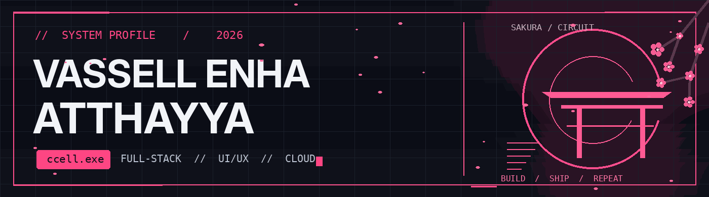
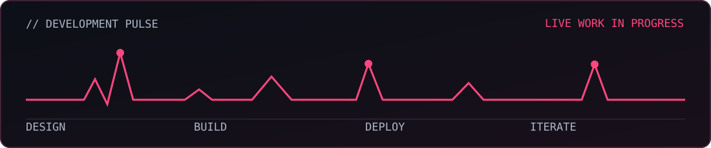

 

 

## 01 / Identity

<table><tr><td width="73%" valign="top">

<h3>Full-Stack Developer. UI/UX-minded.</h3>

I'm <b>Vassell Enha Atthayya</b> (<code>ccell</code>), an Information Systems student at <b>Telkom University</b>. I build practical web experiences, from clean interfaces to functional backend systems.

Currently focused on <b>Laravel, React, Vue.js, and UI/UX design</b> — while exploring cloud deployment, Docker, and Lua for game development.

<pre>const ccell = {
  focus: ["full-stack", "ui/ux", "cloud"],
  currentlyBuilding: "Brread!",
  status: "always shipping"
};</pre>

</td><td width="27%" align="center" valign="top">

</td></tr></table>

## 02 / The toolkit

<b>Expand / Full tech inventory</b>

**Frontend & interface** — HTML, CSS, JavaScript, TypeScript, React, Vue.js, Tailwind CSS, Figma.

**Backend & data** — PHP, Laravel, Node.js, MySQL, Python.

**Tools & learning** — Git, Postman, Docker, cloud platforms, Lua, Roblox Studio.

## 03 / Selected work

<table>
<tr>
<td width="50%" valign="top">

<h3><a href="https://github.com/vassellenha/KWU-BRREAD">BRREAD! / Business Web App</a></h3>

Building an entrepreneurship web application with storefront, staff access, and inventory workflows.

<code>Laravel</code> <code>PHP</code> <code>MySQL</code>

<a href="https://github.com/vassellenha/KWU-BRREAD">Explore repository ↗</a>

</td><td width="50%" valign="top">

<h3><a href="https://github.com/vassellenha/CatchAndClash_Roblox_Project">Catch & Clash / Roblox</a></h3>

Game-development project exploring Roblox experiences and Lua-based gameplay systems.

<code>Roblox Studio</code> <code>Lua</code> <code>Game Development</code>

<a href="https://github.com/vassellenha/CatchAndClash_Roblox_Project">Explore repository ↗</a>

</td></tr>
</table>

<b>More / Vue UI Lab & other projects</b>

**[Vue UI Lab — Advanced Interface Development](https://github.com/vassellenha/PRAKTIKUM_UI-LANJUT_VASSELL-ENHA-ATTHAYYA_102042300140)** — Frontend component architecture, navigation, state and API integration experiments.

**[AMANIN](https://github.com/vassellenha/AMANIN-Project)** — AI-assisted anti-scam product concept.

**[PHARVIA](https://github.com/vassellenha/Pharvia-Project)** — Pharmaceutical return and traceability business concept.

## 04 / Development pulse

 

 

## 05 / Connect

Interested in full-stack development, design systems, cloud platforms, or game-development collaborations? See my work and reach out through the links below.

  

