<picture>
  <source media="(prefers-color-scheme: dark)" srcset="./assets/hero-dark.svg" />
  <source media="(prefers-color-scheme: light)" srcset="./assets/hero-light.svg" />
  
</picture>

I'm Vassell Enha Atthayya, ccell for short. I study Information Systems at Telkom University. I build web apps in Laravel and Vue, design their screens in Figma first, and write Roblox games in Lua on the side.

Right now I'm building [BRREAD!](https://github.com/vassellenha/KWU-BRREAD), which is why it's still a bud on the branch up there. I'm also learning Docker so I can deploy it myself.

Away from the editor, I compete in business model canvas and business proposal competitions, and placed nationally in both in 2026.

### Projects

| | |
|---|---|
| [**BRREAD!**](https://github.com/vassellenha/KWU-BRREAD) | An entrepreneurship web app with a customer storefront, staff roles and inventory tracking. Laravel, PHP, MySQL. |
| [**Catch & Clash**](https://github.com/vassellenha/CatchAndClash_Roblox_Project) | A Roblox game. I wrote the gameplay systems in Lua. |
| [**Vue UI Lab**](https://github.com/vassellenha/PRAKTIKUM_UI-LANJUT_VASSELL-ENHA-ATTHAYYA_102042300140) | Coursework covering Vue components, state, routing and calls to a REST API. |
| [**AMANIN**](https://github.com/vassellenha/AMANIN-Project) | A concept for an AI assistant that helps you decide whether a message is a scam. |
| [**PHARVIA**](https://github.com/vassellenha/Pharvia-Project) | A business concept for tracing pharmaceutical products and handling returns. |

### Tools

Laravel and MySQL on the server, Vue or React with Tailwind in the browser. I test APIs in Postman, and most of my apps end up needing role-based access and SLA workflows. Docker, cloud deployment and Lua are the newest additions.

### Get in touch

I'm looking for full-stack, UI/UX and game projects to build with other people. Message me on [LinkedIn](https://www.linkedin.com/in/vassell-enha-atthayya-182661323) or see more on [my portfolio](https://websiteportofoliokelompok5.vercel.app/) and [Instagram](https://instagram.com/vassellenha).
