<!--
  CCELL.exe: THE PHANTOM DEVELOPER / PERSONA-INSPIRED EDITION
  Visual identity & motion assets are original, created for vassellenha.
  GIF is used intentionally: GitHub strips README JavaScript and sanitizes inline CSS.
  All profile content and outbound URLs can be edited directly in this file.
-->

<a href="https://github.com/vassellenha">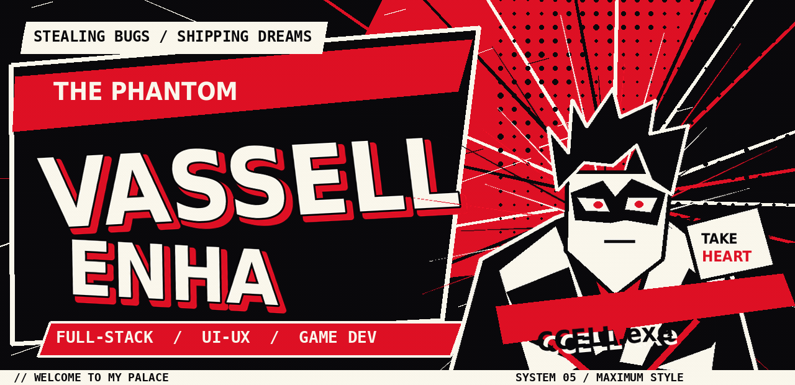</a>

NOW ENTERING THE PALACE OF <strong>VASSELL ENHA ATTHAYYA</strong> · ALSO KNOWN AS <strong>CCELL</strong>

  

<a href="#about">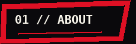</a>

<a href="#missions">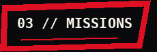</a>
<a href="#status">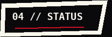</a>
<a href="#contact">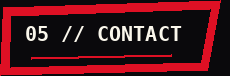</a>

<!-- REAL PROFILE DATA / NO FABRICATED GAME METRICS -->

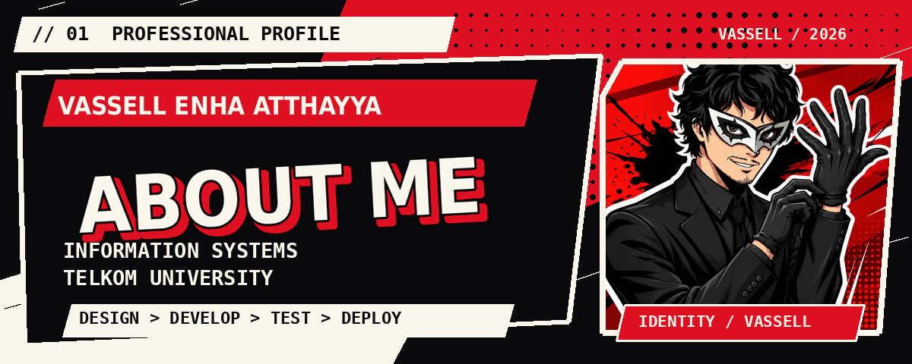

<blockquote>
  <strong>THE PERSON BEHIND THE MASK.</strong> 
  I'm <strong>Vassell Enha Atthayya</strong>, or <strong>ccell</strong>—an Information Systems student at <strong>Telkom University</strong> who builds full-stack web applications, designs interfaces, and explores the systems that make ideas become real products. I like understanding the whole journey, from the database to the deployment.
</blockquote>

| IDENTITY | CURRENT ARC | SIDE QUESTS |
|:--|:--|:--|
| `CCELL.exe` | `Full-Stack / UI-UX` | `Roblox / Lua Game Dev` |
| `Vassell Enha Atthayya` | `Telkom University` | `Docker / Cloud Exploration` |

**Character notes:** I enjoy collaborative builds, learning new tools, and shaping useful products. My journey also includes national-level recognition in 2026 business-model-canvas and business-proposal competitions, as documented in the previous profile.

> **MISSION STATEMENT:** DESIGN THE EXPERIENCE. BUILD THE SYSTEM. SHIP THE THING.

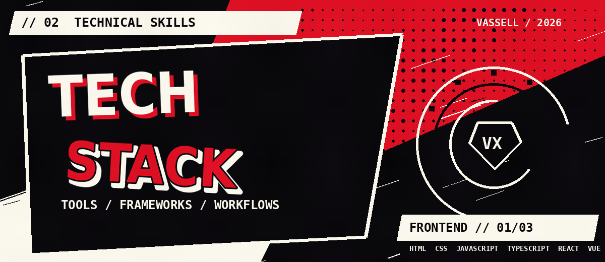

| `01 / FRONTEND` | `02 / BACKEND` | `03 / WORKBENCH + EXPERIMENTS` |
|:--|:--|:--|
| HTML · CSS · JavaScript · TypeScript | PHP · Laravel · Node.js | Git · GitHub · Postman |
| React · Vue · Tailwind CSS | MySQL · Python · REST APIs | VS Code · Figma |
| Interface architecture · UI/UX | Role-based access patterns | Docker · Cloud · Lua · Roblox Studio |

NOTE: Docker, cloud tooling, and Roblox/Lua are part of my ongoing learning and experimentation—not a claim of expert proficiency in everything listed.

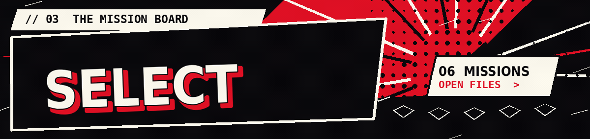

<strong>THE MISSION BOARD // OPEN A DOSSIER TO VIEW THE REAL REPOSITORY</strong>

  

<a href="https://github.com/vassellenha/KWU-BRREAD">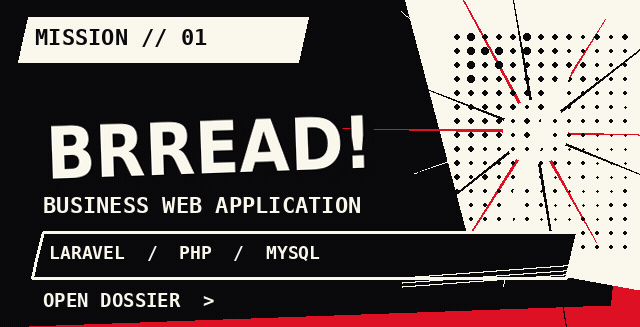</a>
<a href="https://github.com/vassellenha/CatchAndClash_Roblox_Project">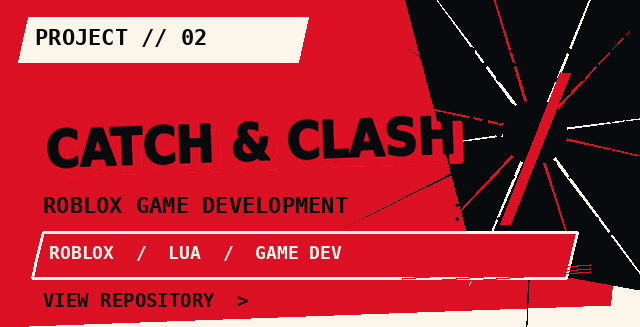</a>

<a href="https://github.com/vassellenha/AMANIN-Project">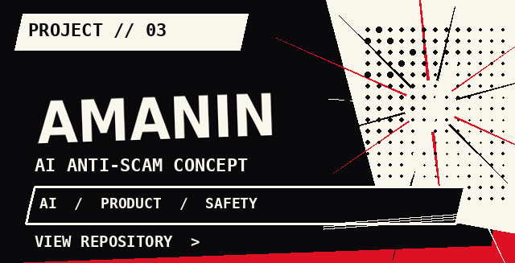</a>
<a href="https://github.com/vassellenha/PHARVIA-Project">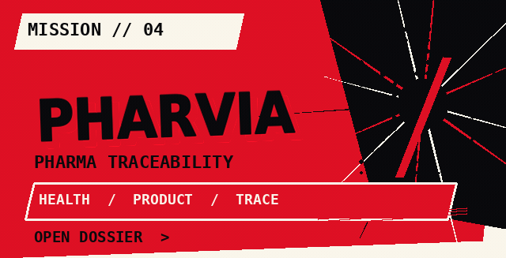</a>

<a href="https://github.com/vassellenha/PRAKTIKUM_UI-LANJUT_VASSELL-ENHA-ATTHAYYA_102042300140">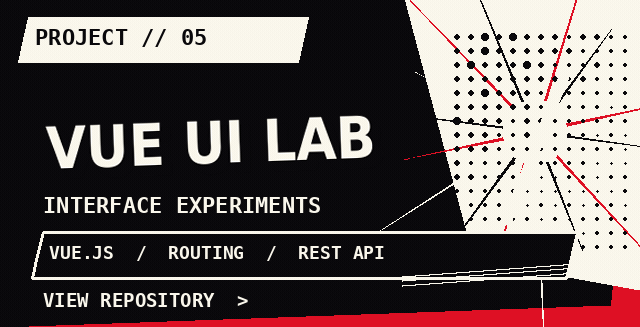</a>
<a href="https://github.com/vassellenha?tab=repositories">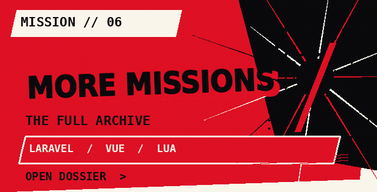</a>

<strong>MISSION FILES / READ THE BRIEFINGS</strong>

| MISSION | ORIGINAL BRIEF | FILE |
|:--|:--|:--|
| `01 / BRREAD!` | Laravel-based entrepreneurship storefront, staff roles and inventory workflows. | [Open repository](https://github.com/vassellenha/KWU-BRREAD) |
| `02 / Catch & Clash` | Roblox game project exploring Lua gameplay systems and player experiences. | [Open repository](https://github.com/vassellenha/CatchAndClash_Roblox_Project) |
| `03 / AMANIN` | AI-assisted anti-scam decision-assistance concept. | [Open repository](https://github.com/vassellenha/AMANIN-Project) |
| `04 / PHARVIA` | Pharmaceutical return and traceability business concept. | [Open repository](https://github.com/vassellenha/PHARVIA-Project) |
| `05 / Vue UI Lab` | Vue components, state management, routing and REST API integration. | [Open repository](https://github.com/vassellenha/PRAKTIKUM_UI-LANJUT_VASSELL-ENHA-ATTHAYYA_102042300140) |

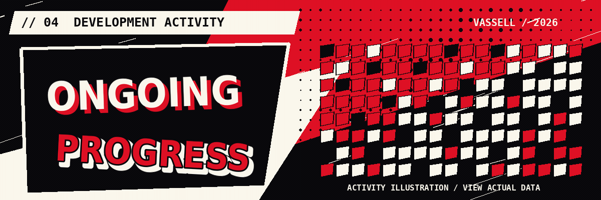

 

Live streak card is supplied by an external service. The animated grid above is original decorative artwork, not a representation of real contribution counts.

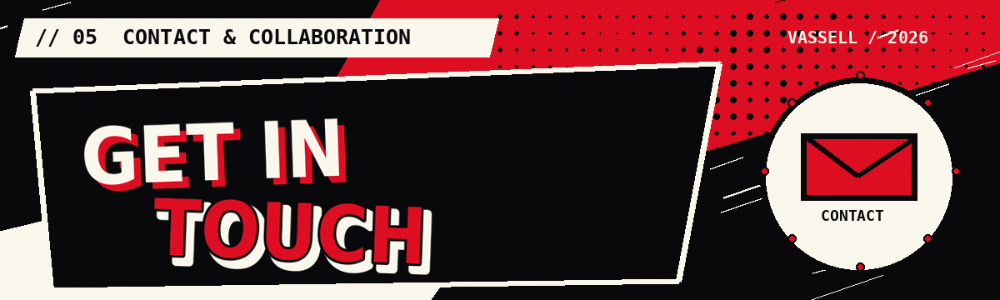

**GOT A PROJECT? AN INTERFACE? A COMPLETELY UNREASONABLE IDEA?**

[**GITHUB // @vassellenha**](https://github.com/vassellenha) &nbsp;·&nbsp; [**LINKEDIN // VASSELL ENHA ATTHAYYA**](https://www.linkedin.com/in/vassell-enha-atthayya-182661323/)  
[**INSTAGRAM // @vassellenha**](https://instagram.com/vassellenha) &nbsp;·&nbsp; [**PORTFOLIO**](https://websiteportofoliokelompok5.vercel.app/)

 

<a href="https://github.com/vassellenha">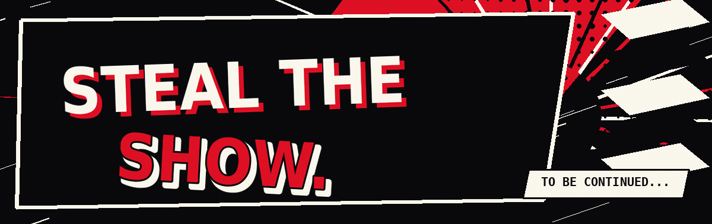</a>

CCELL.exe // THE PHANTOM DEVELOPER — FAN-INSPIRED ORIGINAL GRAPHIC DESIGN

 

<a href="#top">▲ BACK TO THE TOP / NEW GAME+</a>

